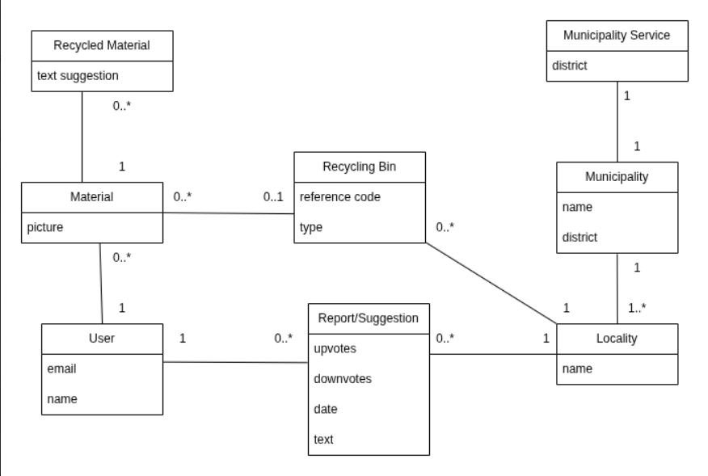
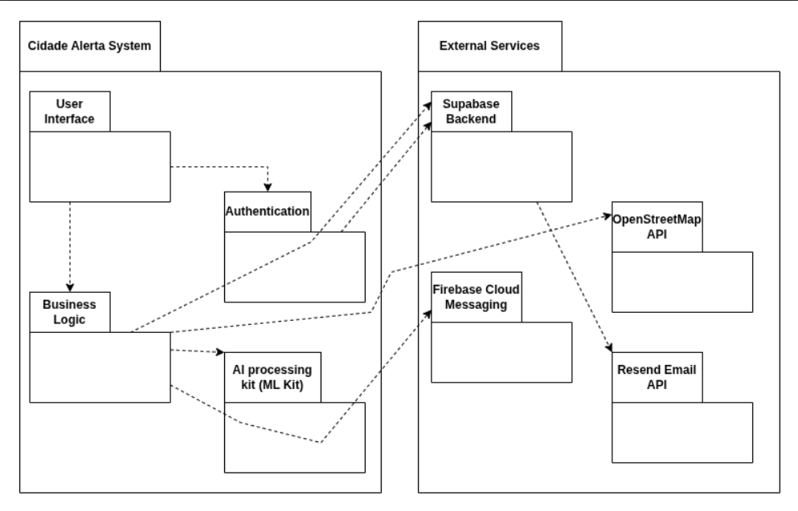
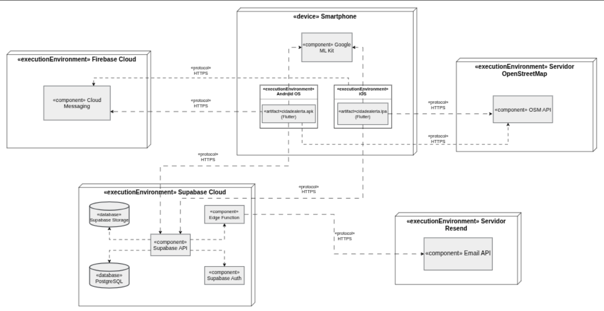

# 2LEIC11T5
<!-- Template file for README.md for LEIC-ES-2025-26 -->
<!-- [!NOTE] In this file, you will find the structure you should follow to document your mobile app in the README.md file for LEIC-ES-2025-26. It is a single file with guidelines, as comments, only seen in Edit mode, not in Preview mode. You can add more sections, but for assessment reasons and automation, please make sure to include all sections of this template. Your professors will clarify about specificities of your app.-->

# _Cidade Alerta_ Development Report

Welcome to the documentation of _Cidade Alerta_!

This Software Development Report, tailored for LEIC-ES-2025-26, provides comprehensive details about _Cidade Alerta_, starting from an high-level vision and going into low-level implementation decisions. 

It is organised by the following activities: 

* [Business modeling](#Business-Modelling) 
  * [Product Vision](#Product-Vision)
  * [Features and Assumptions](#Features-and-Assumptions)
* [Requirements](#Requirements)
  * [User stories](#User-stories)
  * [Domain model](#Domain-model)
  * [User interfaces](#User-interfaces)
  * [Validate Requirements](#mpirical-Validation)
* [Architecture and Design](#Architecture-And-Design)
  * [Logical architecture](#Logical-Architecture)
  * [Physical architecture](#Physical-Architecture)
  * [Functional prototype](#Functional-Prototype)
* [Project management](#Project-Management)
  * [Sprint 0](#Sprint-0)
  * [Sprint 1](#Sprint-1)
  * [Sprint 2](#Sprint-2)
  * [Sprint 3](#Sprint-3)
  * [Final Release](#Final-Release)

Contributions are expected to be made exclusively by the initial team, but we may open them to the community, after the course, in all areas and topics: requirements, technologies, development, experimentation, testing, etc.

Please contact us!

Thank you!

* André Sousa (<u>up202404210@up.pt</u>)
* Pedro Domingos (<u>up202404098@up.pt</u>)
* Ricardo Alves (<u>up202404099@up.pt</u>)
* Rui Brochado (<u>up202405335@up.pt</u>)

---
## Business Modelling

Business modeling in software development involves defining the product's vision, understanding market needs, aligning features with user expectations, and setting the groundwork for strategic planning and execution.

### Product Vision

For frustrated residents, "Cidade Alerta" is a civic action app that transforms photos of urban issues into direct municipal solutions. Unlike slow government portals, we bypass bureaucracy by routing verified reports directly to authorities with total transparency of the resolution status to the users.
<!-- 
Start by defining a clear and concise product vision for your app, to help members of the team, contributors, and users into focusing their often disparate views into a concise, visual, and short textual form. 

The vision should provide a "high concept" of the product for marketers, developers, and managers.

A product vision describes the essential of the product and sets the direction to where a product is headed, and what the product will deliver in the future. 

**We favor a catchy and concise statement, ideally one sentence.**

We suggest you use the product vision template described in the following link:
* [How To Create A Convincing Product Vision To Guide Your Team, by uxstudioteam.com](https://uxstudioteam.com/ux-blog/product-vision/)

To learn more about how to write a good product vision, please read:
* [Vision, by scrumbook.org](http://scrumbook.org/value-stream/vision.html)
* [Product Management: Product Vision, by ProductPlan](https://www.productplan.com/glossary/product-vision/)
* [20 Inspiring Vision Statement Examples (2019 Updated), by lifehack.org](https://www.lifehack.org/articles/work/20-sample-vision-statement-for-the-new-startup.html)
-->

### Features and Assumptions
<!-- 
Indicate an  initial/tentative list of high-level features - high-level capabilities or desired services of the system that are necessary to deliver benefits to the users.
 - Feature XPTO - a few words to briefly describe the feature
 - Feature ABCD - ...
...

Optionally, indicate an initial/tentative list of assumptions that you are doing about the app and dependencies of the app to other systems.
-->

## Requirements

### User Stories
<!-- 
In this section you should describe all kinds of requirements for your module: functional and non-functional requirements.

For LEIC-ES-2025-26, the requirements will be gathered and documented as user stories. 

Please add in this section a concise summary of all the user stories (not each user story!).

**User stories as GitHub Project Items**
The user stories themselves should be created and described as items in your GitHub Project with the label "user story". 

A user story is a description of a desired functionality told from the perspective of the user or customer. A starting template for the description of a user story is *As a < user role >, I want < goal > so that < reason >.*

Name the item with either the full user story or a shorter name (recommended). In the “comments” field, add relevant notes, mockup images, and acceptance test scenarios, linking to the acceptance tests when available, and finally estimate value and effort.

**INVEST in good user stories**. 
You may add more details after, but the shorter and complete, the better. In order to decide if the user story is good, please follow the [INVEST guidelines](https://xp123.com/articles/invest-in-good-stories-and-smart-tasks/).

**User interface mockups**.
After the user story text, you should add a draft of the corresponding user interfaces, a simple mockup or draft, if applicable.

**Acceptance tests**.
For each user story you should write also the acceptance tests (textually in [Gherkin](https://cucumber.io/docs/gherkin/reference/)), i.e., a description of scenarios (situations) that will help to confirm that the system satisfies the requirements addressed by the user story.

**Value and effort**.
At the end, it is good to add a rough indication of the value of the user story to the customers (e.g. [MoSCoW](https://en.wikipedia.org/wiki/MoSCoW_method) method) and the team should add an estimation of the effort to implement it using points in a kind-of-a Fibonnacci scale (1,2,3,5,8,13,20,40, no idea).

-->

### Domain model

Our application is a civic and environmental platform that connects citizens to municipal services to improve waste management and public spaces. The system allows a User to register pictures of Materials to learn how to handle them correctly (through Recycled Material categories with text suggestions) and direct them to the appropriate Recycling Bin.
In parallel, the application works as a reporting and continuous improvement network: users can create geolocated Reports or Suggestions in a specific Locality (for example, reporting a damaged recycling bin or accumulated trash around the Asprela campus). These reports feature a community evaluation system (upvotes/downvotes) that helps to prioritize issues. All physical (Recycling Bins) and social (Reports) infrastructure is mapped by Localities, allowing the Municipality (such as the Porto City Council) and its respective Municipal Services to manage their collection network and act faster and more directly according to the population's needs.

### Empirical Validation

<!-- 
Select persons from your app's target users and do one of the following: 
 * 2-3 interviews, 
 * or 8-12 surveys, 
 * or 2-3 demos. 
 
Collect the feedback and reflect it in the PBL, refining it, by reordering PBIs, adding new ones, etc. 

-->

## Architecture and Design
<!--
The architecture of a software system encompasses the set of key decisions about its organization. 

A well written architecture document is brief and reduces the amount of time it takes new programmers to a project to understand the code to feel able to make modifications and enhancements.

To document the architecture requires describing the decomposition of the system in their parts (high-level components) and the key behaviors and collaborations between them. 

In this section you should start by briefly describing the components of the project and their interrelations. You should describe how you solved typical problems you may have encountered, pointing to well-known architectural and design patterns, if applicable.
-->

### Logical architecture

The logical architecture diagram illustrates the high-level organization of the Cidade Alerta application, emphasizing the separation of concerns between internal modules and external dependencies.

**1. Cidade Alerta System (Internal Modules)**
This package represents the core application running on the user's device, structured into four main components:
* **User Interface (UI):** The presentation layer responsible for handling citizen interactions, rendering screens (maps, camera, feeds), and capturing input. It is kept "dumb" and delegates all data processing to the underlying layers.
* **Business Logic:** The brain of the application. It enforces system rules (e.g., calculating points, assigning municipalities), processes raw data, and orchestrates the communication between the UI and the external APIs.
* **Authentication:** A dedicated module that manages user sessions, registration, and login states, ensuring secure access to the platform.
* **AI Processing Kit (ML Kit):** A local module invoked by the Business Logic to analyze and classify captured images (e.g., identifying the type of waste) entirely on-device, without relying on external network requests.

**2. External Services**
This package groups the third-party platforms and APIs consumed by the application to expand its capabilities:
* **Supabase Backend:** Acts as the primary backend-as-a-service (BaaS). It provides the database (PostgreSQL), file storage for images, and validates requests from the Authentication module. 
* **Stadia Maps API:** Consumed directly by the Business Logic to fetch high-quality map tiles and perform geocoding (translating raw GPS coordinates into street addresses).
* **Firebase Cloud Messaging:** Used by the application to push real-time notifications to the users' smartphones (e.g., status updates on reported issues).
* **Resend Email API:** An external mailing service. Unlike the other APIs, it is not called by the mobile app, but rather invoked directly by the Supabase Backend (via Edge Functions) to dispatch automated email alerts to the respective municipal authorities.

### Physical architecture

The physical architecture diagram presents five main nodes: 

* **Smartphone:** represents the user's mobile device running the Flutter application (APK/IPA) and interacting with the citizen. It also integrates Google ML Kit locally to scan and classify images without needing network requests. 

* **Supabase Cloud:** acts as the core backend of the application. It manages user authentication, stores structured data (PostgreSQL) and media files (Storage), and runs server-side logic through Edge Functions. 

* **Stadia Cloud:** an external service that provides map rendering (map tiles) and geocoding services directly to the mobile app via API.

* **Firebase Cloud:** responsible for delivering push notifications to the users. 

* **Resend Server:** an external email infrastructure that receives commands from the Supabase Edge Functions to send automated alerts directly to the municipalities.

### Functional prototype
<!--
To help on validating all the architectural, design and technological decisions made, we usually implement a functional prototype, a thin vertical slice of the system integrating as much technologies as we can.

In this subsection please describe which feature, or part of it, you have implemented, and how, together with a snapshot of the user interface, if applicable.

At this phase, instead of a complete user story, you can simply implement a small part of a feature that demonstrates thay you can use the technology, for example, show a screen with the app credits (name and authors).
-->

## Project management
<!--
Software project management is the art and science of planning and leading software projects, in which they are planned, implemented, monitored and controlled.

In the context of ESOF, we recommend each team to adopt a set of project management practices and tools capable of registering tasks, assigning tasks to team members, adding estimations to tasks, monitor tasks progress, and therefore being able to track their projects.

Common practices of managing agile software development with Scrum are: backlog management, release management, estimation, Sprint planning, Sprint development, acceptance tests, and Sprint retrospectives.

You can find below information and references related with the project management: 

* Backlog management: Product backlog and Sprint backlog in a [Github Projects board](https://github.com/orgs/FEUP-LEIC-ES-2023-24/projects/64);
* Release management: [v0](#), v1, v2, v3, ...;
* Sprint planning and retrospectives: 
  * plans: screenshots of Github Projects board at begin and end of each Sprint;
  * retrospectives: meeting notes in a document in the repository, addressing the following questions:
    * Did well: things we did well and should continue;
    * Do differently: things we should do differently and how;
    * Puzzles: things we don’t know yet if they are right or wrong;
    * list of a few improvements to implement next Sprint;

-->

### Sprint 0
**Project Board**

Start of Sprint 0

End of Sprint 0

**Sprint Retrospective:**

* Did well:
  * S
  * S
  * A
* Do differently:
  * B
  * A
* Puzzles:
  * B
 
### Sprint 1

### Sprint 2

### Sprint 3

### Sprint 4

### Final Release

