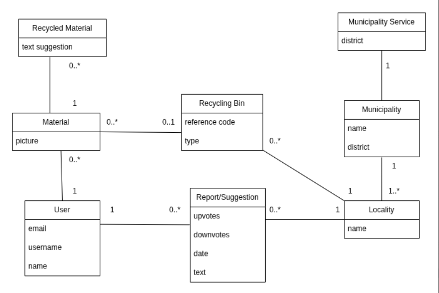

# app

A new Flutter project.

## UML Domain Model

Our application is a civic and environmental platform that connects citizens to municipal services to improve waste management and public spaces. The system allows a User to register pictures of Materials to learn how to handle them correctly (through Recycled Material categories with text suggestions) and direct them to the appropriate Recycling Bin.

In parallel, the application works as a reporting and continuous improvement network: users can create geolocated Reports or Suggestions in a specific Locality (for example, reporting a damaged recycling bin or accumulated trash around the Asprela campus). These reports feature a community evaluation system (upvotes/downvotes) that helps to prioritize issues. All physical (Recycling Bins) and social (Reports) infrastructure is mapped by Localities, allowing the Municipality (such as the Porto City Council) and its respective Municipal Services to manage their collection network and act faster and more directly according to the population's needs.
