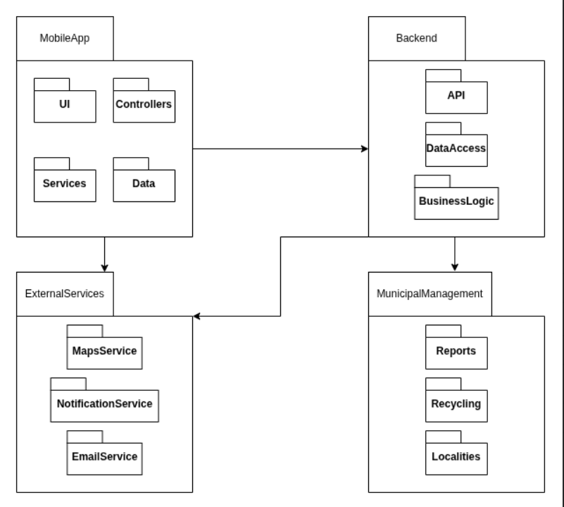

### Logical architecture

The logical architecture diagram illustrates the high-level organization of the application, emphasizing the separation of concerns across four main packages and their respective dependencies.

### 1. MobileApp
This package represents the core application running on the user's device, structured using a presentation architectural pattern (like MVVM):

* **UI:** The presentation layer responsible for handling user interactions and rendering screens. It delegates data handling to the underlying layers.
* **ViewModel:** Acts as the bridge between the UI and the services, managing presentation state, user input logic, and updating the views.
* **Service:** Handles local operations and orchestrates data flows. As shown by the dependencies, this layer communicates directly with both the **Backend** and specific **ExternalServices**.

### 2. Backend
This package represents the server-side infrastructure, which is consumed by the MobileApp. It follows a standard layered architecture:

* **API:** Exposes the necessary endpoints (e.g., REST or GraphQL) for the mobile client to communicate with the server.
* **BusinessLogic:** The core layer where the system's rules are enforced. It orchestrates data processing and connects with both the database layer and external modules.
* **DataAccess:** Responsible for database interactions, abstracting the storage, querying, and retrieval of information.

### 3. ExternalServices
This package groups the third-party platforms and APIs consumed by the system to expand its capabilities. It is accessed by both the **MobileApp** and the **Backend**:

* **MapsService:** Provides map rendering, geocoding, and location-based functionalities.
* **NotificationService:** Handles the delivery of real-time alerts and push notifications to the users' devices.
* **EmailService:** An external mailing service used for dispatching automated communications and alerts.

### 4. MunicipalManagement
A dedicated domain package that the **Backend** relies on to organize core entities related to city operations:

* **Reports:** Manages the submission, tracking, and lifecycle of the specific issues reported by citizens.
* **Recycling:** Handles operations, data, and business rules related to waste management and recycling points.
* **Localities:** Manages data concerning municipal zones, administrative regions, and specific geographic areas.
