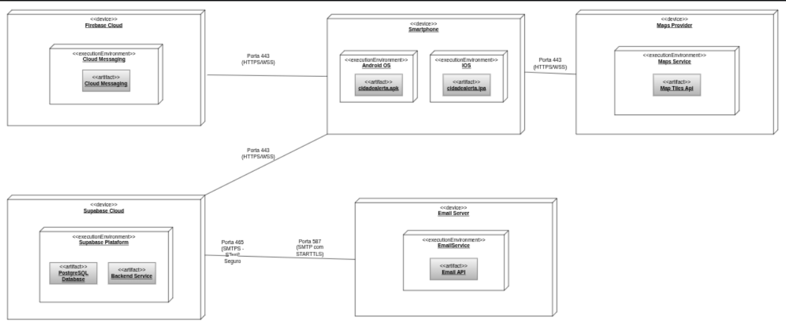

### Physical architecture

The physical architecture (deployment) diagram presents five main device nodes communicating securely via HTTPS:

* **Smartphone:** Represents the user's mobile device. It features two distinct execution environments: **Android OS** (running the `cidadealerta.apk` artifact) and **iOS** (running the `cidadealerta.ipa` artifact). This node acts as the central client, interacting with the citizen and communicating directly with the backend and external APIs.
* **Supabase Cloud:** Acts as the core backend of the application. Its execution environment (`Supabase Platform`) hosts the `PostgreSQL Database` artifact for structured data storage and the `Backend Service` artifact to manage server-side logic and API requests coming from the smartphone.
* **Maps Provider:** An external service node hosting the `Maps Service` execution environment. It provides the `Map Tiles Api` artifact, which is consumed directly by the mobile app for map rendering and location-based features.
* **Firebase Cloud:** Responsible for delivering push notifications to the users. It hosts the `Cloud Messaging` execution environment and artifact, communicating directly with the client's smartphone.
* **Email Server:** An external email infrastructure that hosts the `EmailService` execution environment and its `Email API` artifact. Unlike the other external services, it receives backend commands directly from the **Supabase Cloud** to dispatch automated alerts (e.g., to municipal authorities).
