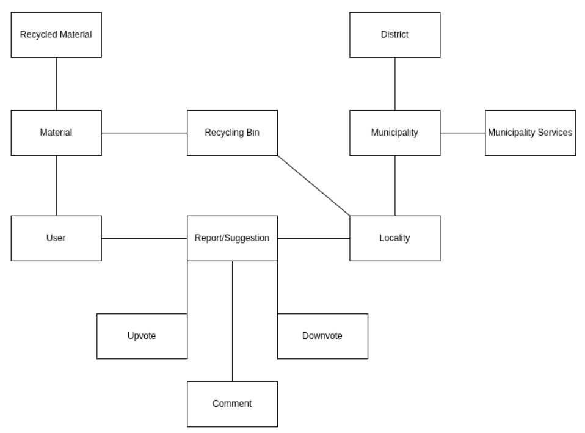

### Domain model

Our application is a civic and environmental platform that connects citizens to municipal services to improve waste management and public spaces. The system allows a **User** to register **Materials** to learn how to handle them correctly (categorized into specific **Recycled Material** types) and direct them to the appropriate **Recycling Bin**.

In parallel, the application works as a reporting and continuous improvement network. Users can create geolocated **Reports/Suggestions** linked to a specific **Locality** (for example, reporting a damaged recycling bin or accumulated trash around the Asprela campus). To foster community engagement, these reports feature an interaction system allowing users to leave a **Comment**, as well as evaluate issues via **Upvote** or **Downvote** to help prioritize them.

All physical (**Recycling Bin**) and social (**Report/Suggestion**) infrastructure is mapped to a **Locality**. These localities belong to a specific **Municipality**, which in turn falls under a broader **District**. This hierarchical organization allows the **Municipality** (such as the Porto City Council) and its respective **Municipality Services** to manage their collection network efficiently and act faster according to the population's needs.
